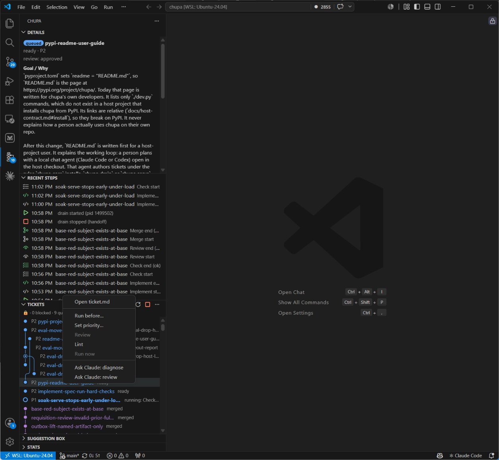
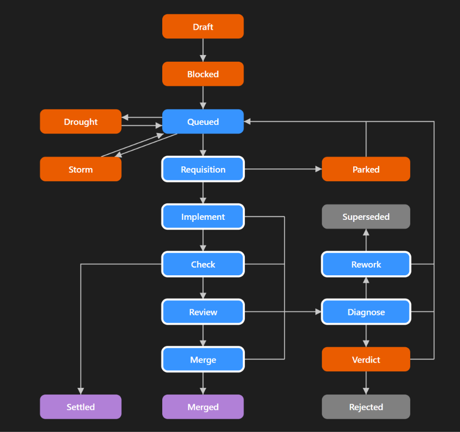

# chupa tickets

A VS Code extension for the [chupa](https://pypi.org/project/chupa/) ticket system. View chupa tickets in the Activity Bar. The Tickets view shows the dependency graph and ticket states; Details shows the selected ticket or Suggestion Box message. Recent Steps shows engine activity, Suggestion Box lists messages, and Stats shows health figures.

Built for [chupa 0.1.4](https://pypi.org/project/chupa/0.1.4/).

## Prerequisites

Open a repository containing `tickets/` and [install chupa](https://github.com/protus75/chupa/blob/main/chupa/docs/host-contract.md#install).

The `chupa.command` setting is the command and arguments used to run the engine. The default is `[".venv/bin/chupa"]`, resolved from the workspace folder. Override it when the executable is elsewhere, including on native Windows. A missing command shows a `chupa command not found` message naming the `chupa.command` setting.

On WSL or Remote-SSH, the extension runs on the remote side, where the repository and chupa command are available.
